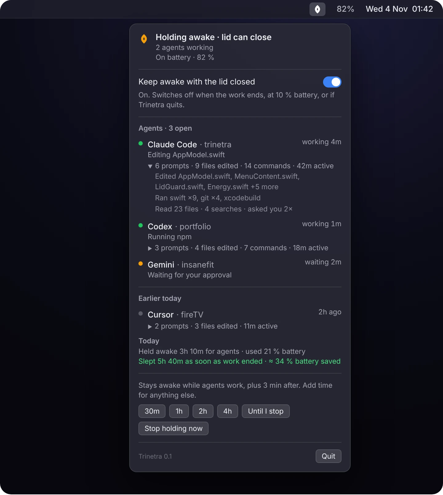
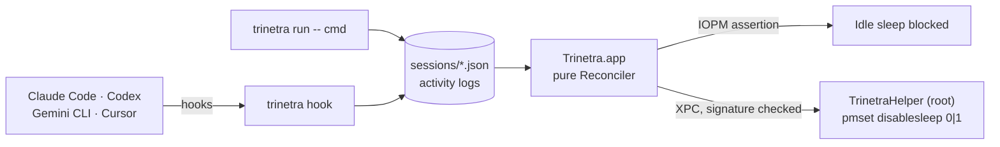

<p align="center">
  
</p>

<h1 align="center">Trinetra</h1>

<p align="center">
  <b>Remote Control only works while your Mac is awake. Trinetra keeps it awake.</b>
</p>

<p align="center">
  A free, open-source macOS menu bar app and CLI that keeps your MacBook awake, <b>lid closed included</b>,<br>
  while <b>Claude Code, Codex, Gemini CLI or Cursor</b> agents are working, then lets it sleep.<br>
  An agent-aware alternative to Amphetamine, Caffeine and <code>caffeinate</code>.
</p>

<p align="center">
  <a href="https://github.com/animeshbasak/trinetra/actions/workflows/ci.yml"></a>
  
  
  
  <a href="LICENSE"></a>
  <a href="https://github.com/animeshbasak/trinetra/stargazers"></a>
</p>

<p align="center">
  <a href="#features">Features</a> ·
  <a href="#agent-hooks">Agent hooks</a> ·
  <a href="#install">Install</a> ·
  <a href="#cli">CLI</a> ·
  <a href="#faq">FAQ</a> ·
  <a href="https://animeshbasak.github.io/trinetra/">Website</a>
</p>

<p align="center">
  
</p>

---

## Why

You start a long task in Claude Code or Codex, pick it up on your phone with Remote Control, close the lid and walk away. Then the MacBook sleeps and the session dies.

`caffeinate` and Amphetamine fix half of that. They don't know when your agents are done, and on battery they can't stop lid-close sleep. So you either babysit a timer or leave the Mac awake all night.

Trinetra (Sanskrit for "three-eyed") watches your agents through their own hooks. While one is working, or a timer you set is running, it holds the Mac awake, with the lid closed if you want. When the work is done it lets go, and your Mac sleeps like it always did.

## Features

| | |
|---|---|
| 👁 **Agent-aware** | Awake exactly while Claude Code, Codex / ChatGPT, Gemini CLI or Cursor is working, plus a 3-minute grace period. Nothing to remember to turn off |
| 💻 **Lid closed, on battery** | Keeps the Mac awake with the lid shut, through a tiny privileged helper you approve once. Turns itself off when the work ends |
| 🧭 **Live agent list** | Every open session in the menu: agent, project, state and what it's doing right now ("Editing AppModel.swift", "Running swift", "Waiting for your approval") |
| 📝 **Session summaries** | What each agent did: prompts, files edited and read, commands run, searches, approvals, active time. In the menu and in `trinetra summary` |
| 🔋 **Battery saved** | How long agents kept the Mac awake today, the battery that cost, and an estimate of battery saved by sleeping as soon as the work ended |
| ⏱ **Timers** | 30m · 1h · 2h · 4h · Until I stop, for builds, downloads or anything without hooks |
| ▶️ **Wrap any command** | `trinetra run -- ./train.sh` holds the Mac awake for exactly as long as the command runs |
| 🛡 **Safe by default** | 10 % battery floor, thermal cutout, 12 h cap. Normal sleep comes back if the app quits, crashes or goes quiet for 2 minutes |
| 🌙 **Calm** | An animated third eye in the menu bar: open while holding, a blink now and then, closed when idle. Respects Reduce Motion |
| 🔒 **Private** | No telemetry, no network calls, no prompt text stored. Ever |

<p align="center">
  
</p>

Trinetra does **not** relay prompts or approve permissions. Claude and ChatGPT already do that well. It only makes sure the Mac stays awake for them.

## Agent hooks

Coding agents can run a command when something happens: a prompt is sent, a tool is about to run, the turn ends. Trinetra adds one tiny command to each of those moments:

```bash
trinetra hook <agent> <state>      # e.g. trinetra hook claude working
```

It reads the event the agent passes on stdin, writes one line to a local session file, and exits 0 in milliseconds. It never blocks, never answers a permission prompt and never fails the agent, whatever goes wrong.

### What gets hooked

| Agent | Config file | Working | Waiting for you | Idle / ended |
|---|---|---|---|---|
| **Claude Code** | `~/.claude/settings.json` | `UserPromptSubmit` `PreToolUse` | `Notification` (permission) | `SessionStart` `Stop` `Notification` (idle) / `SessionEnd` |
| **Codex / ChatGPT** | `~/.codex/hooks.json` | `UserPromptSubmit` `PreToolUse` `PostToolUse` | `PermissionRequest` | `SessionStart` `Stop` `Interrupt` / `SessionEnd` |
| **Gemini CLI** | `~/.gemini/settings.json` | `BeforeAgent` `BeforeTool` `AfterTool` | `Notification` | `SessionStart` `AfterAgent` / `SessionEnd` |
| **Cursor** | `~/.cursor/hooks.json` | `beforeSubmitPrompt` `afterFileEdit` `afterShellExecution` `postToolUse` | – | `sessionStart` `stop` / `sessionEnd` |

### What each state drives

| State | Mac | Menu | Summary |
|---|---|---|---|
| **Working** | Held awake (lid closed too, if lid mode is on) | Green dot + current activity, e.g. "Editing LidGuard.swift" | Counts the prompt, edit, read, command, search or web lookup |
| **Waiting for you** | Held awake, so your phone can still approve | Orange dot, "Waiting for your approval" | Counts an approval |
| **Idle** | Released after the 3-minute grace period | Grey dot, "Waiting for your next prompt" | Closes the turn and its active time |
| **Ended** | Released | Moves to "Earlier today" | Final summary kept for 24 h |

If an agent crashes without saying goodbye, Trinetra notices the process is gone and lets go anyway.

### Installing them safely

```bash
trinetra hooks install claude      # or codex, gemini, cursor
trinetra hooks uninstall claude
```

- **Backs up first.** The original file is saved as `<file>.trinetra.bak` before the first change.
- **Leaves your hooks alone.** Only Trinetra's own entries are added or removed. Your other hooks, matchers and settings stay exactly as they were.
- **Refuses broken files.** If the config isn't valid JSON, nothing is changed and you're told why.
- **Idempotent.** Running install twice gives the same file. Uninstall removes every trace, including empty groups it created.
- **Codex** asks you to trust new hooks once: run `/hooks` inside Codex after installing.
- **Cursor** gets observational events only. Its permission hooks expect a JSON answer, and Trinetra never answers for you.

This is what install adds to Claude Code's settings, next to anything already there:

```json
"UserPromptSubmit": [
  { "hooks": [{ "type": "command", "command": "/Users/you/.local/bin/trinetra hook claude working", "timeout": 5 }] }
]
```

## Session summaries

Every hook event also lands in a per-session activity log, so Trinetra can tell you what an agent actually did while you were away. Click a session in the menu, or run:

```text
$ trinetra summary
Claude Code · trinetra · working
   6 prompts · 9 files edited · 14 commands · 42m active
   Edited AppModel.swift, MenuContent.swift, LidGuard.swift, Energy.swift +5 more
   Ran swift ×9, git ×4, xcodebuild
   Read 23 files · 4 searches · asked you 2×
Codex · portfolio · 12m ago
   3 prompts · 4 files edited · 7 commands · 18m active

Today: held awake 3h 10m over 4 holds, used 21 % battery
Slept 5h 40m as soon as work ended ≈ 34 % battery saved vs staying awake
```

Only labels are stored: the tool, a file name, a command's first word. Never prompt text, replies, file contents or full command lines.

## Battery saved

Trinetra records each hold: when it started and ended, and the battery level at both ends. That gives it your Mac's real drain per awake hour (8 %/h until it has enough data). When a hold ends and the Mac goes to sleep within 15 minutes, the time it then sleeps is credited at that rate. The result is how much battery staying awake "just in case" would have cost. It's an estimate, and the menu labels it as one.

## Lid-closed mode

macOS ignores normal power assertions when you close the lid on battery. The only switch that stops lid-close sleep is `pmset disablesleep`, and it needs root.

Trinetra ships a single-purpose helper (`TrinetraHelper`, a LaunchDaemon registered with `SMAppService`) that you approve once in **System Settings › General › Login Items › Allow in the Background**. The helper:

- runs exactly `/usr/bin/pmset -a disablesleep 0` or `1`. No shell, no paths, no strings from the caller
- accepts XPC calls only from the Trinetra app signed by the same team
- restores normal sleep the moment the app disconnects (quit, crash or rebuild), after 2 minutes without a heartbeat, and on every launch

No sudoers rule, no password per session, and nothing that can be left switched on.

## How it works



- **Idle sleep** is blocked with the same power assertion `caffeinate -i` uses. No privileges needed.
- **The decision** (awake or not, lid mode, low power, safety stop) is one pure, unit-tested function. See [`architecture/HLD.md`](architecture/HLD.md) and [`architecture/LLD.md`](architecture/LLD.md).

## Install

Requirements, while there's no prebuilt download yet:

| Requirement | Why |
|---|---|
| **macOS 13 Ventura or later** | The helper is registered with `SMAppService` and the menu is a SwiftUI `MenuBarExtra`. Both arrived in macOS 13 |
| **Xcode 16+** | You build the app yourself, and the committed project uses the Xcode 16 format. XcodeGen users can regenerate it from `project.yml` |
| **Free Apple ID signing team** | macOS only runs the root helper for a signed app, and the helper only obeys an app signed by the same team. A free Personal Team in Xcode is enough; no paid developer account |

```bash
git clone https://github.com/animeshbasak/trinetra.git
cd trinetra
scripts/install-cli.sh                   # builds and installs ~/.local/bin/trinetra
trinetra hooks install claude            # Claude Code
trinetra hooks install codex             # Codex / ChatGPT (then /hooks in Codex to trust)
trinetra hooks install gemini            # Gemini CLI
trinetra hooks install cursor            # Cursor
open Trinetra.xcodeproj                  # set your signing team on both targets, then Run
```

1. Copy the built **Trinetra.app** to `/Applications` and open it from there. The helper registers reliably only from a real install location.
2. Put your own team ID in `Helper/main.swift` (`certificate leaf[subject.OU]`). The helper only talks to an app signed by that team.
3. Turn on **Keep awake with the lid closed** in the menu, then allow **Trinetra** under **Login Items › Allow in the Background**.

`project.yml` is kept for [XcodeGen](https://github.com/yonaskolb/XcodeGen) users. A notarized DMG and Homebrew cask are on the roadmap.

## CLI

```text
trinetra status [--json]            What's running and what Trinetra would do
trinetra start 2h                   Keep awake for a duration (30m, 2h, 1h30m)
trinetra extend 30m                 Add time to the timer
trinetra stop                       Stop holding now (new agent activity resumes)
trinetra run -- <command>           Keep awake while a command runs
trinetra summary                    What each agent did (24 h) + battery saved today
trinetra hooks install|uninstall <claude|codex|gemini|cursor>
```

## FAQ

**How do I keep my MacBook awake with the lid closed without an external display?**
Turn on **Keep awake with the lid closed** in Trinetra and approve its helper once. While an agent is working or a timer runs, closing the lid won't sleep the Mac, on battery too. When the work ends, normal sleep comes back by itself.

**Does Claude Code Remote Control keep working when I close the lid?**
Only while the Mac is awake. A sleeping Mac drops the session. With Trinetra's lid mode on, Remote Control, Codex on your phone and similar sessions keep running with the lid shut while the agent works.

**How is this different from Amphetamine, Caffeine or `caffeinate`?**
Those keep the Mac awake until you stop them, and they can't block lid-close sleep on battery. Trinetra holds only while your agents are working, covers the lid, then releases, so it doesn't drain your battery overnight.

**Is it safe to run a closed MacBook?**
It uses power and makes heat. Use a hard, ventilated surface, never a closed bag. `pmset disablesleep` also switches off macOS's own low-battery sleep, which is why Trinetra's 10 % battery floor and thermal cutout can't be turned off.

**Does Trinetra read my prompts or code?**
No. Hooks record the agent, the project folder name, the state and a short label (a file name or a command's first word). Nothing leaves your Mac.

**How do I uninstall it?**
Run `trinetra hooks uninstall <agent>` for each agent, quit Trinetra and delete it from `/Applications`. Normal sleep is restored as soon as the app quits.

## Compared with

| | Agent-aware | Lid closed on battery | Agent list + summaries | Auto-release | Privilege model |
|---|---|---|---|---|---|
| **Trinetra** | ✅ 4 agents | ✅ | ✅ | ✅ | Single-purpose helper, disconnect + dead-man revert |
| Adrafinil | ✅ | ✅ | – | ✅ | Single-purpose helper |
| Insomnia | timer | ✅ | – | timer | sudoers rule |
| Amphetamine | – | partial | – | timer | App Store sandbox |
| `caffeinate` | – | – | – | per command | none |

## Roadmap

- [x] Agent-aware holds, timers, `trinetra run`
- [x] Lid-closed mode through a privileged helper
- [x] Claude Code, Codex, Gemini CLI and Cursor hooks, live agent list
- [x] Session summaries and battery-saved estimate
- [x] Animated menu bar eye
- [ ] Remote-session hold for `claude --remote-control` between prompts
- [ ] Phone alerts (Telegram) for battery, heat, Wi-Fi and hold ended
- [ ] Notarized DMG + Homebrew cask

## Contributing

Issues and pull requests are welcome. Run `swift test` in `Packages/TrinetraCore` before sending one. New agent support usually means one entry in `HookInstaller.swift`, its tool names in `ActivitySummary.swift`, and a test.

If Trinetra saved one of your agent sessions, a ⭐ helps other people find it.

## Licence

MIT © 2026 [Animesh Basak](https://github.com/animeshbasak)
