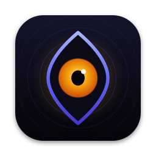

<p align="center">
  
</p>

<h1 align="center">Trinetra</h1>

<p align="center">
  <b>Remote Control only works while your Mac is awake. Trinetra keeps it awake.</b><br>
  A tiny macOS menu bar app that keeps your MacBook awake, lid closed included, exactly while your AI agents are working, then lets it sleep.
</p>

<p align="center">
  
  
  
  
  
</p>

<p align="center">
  
</p>

---

You start a long task in Claude Code or Codex, connect from your phone with Remote Control, close the lid and walk away. Then the MacBook sleeps and the session dies.

Trinetra (Sanskrit for "three-eyed") watches your agents. While one is working or a timer is running, it holds the Mac awake. When the work is done it lets go, and your Mac sleeps like it always did.

## Features

| | |
|---|---|
| 👁 **Agent-aware** | Awake while Claude Code or Codex is working, plus a short grace period. Nothing to remember to turn off |
| 💻 **Lid closed** | Keeps the Mac awake with the lid shut, on battery too, through a tiny privileged helper you approve once |
| 🧭 **See your agents** | The menu lists every open session: project, state, and what it's doing ("Editing AppModel.swift", "Running swift test", "Waiting for approval") |
| ⏱ **Timers** | 30m · 1h · 2h · 4h · Until I stop, for builds, downloads or anything without hooks |
| ▶️ **Wrap any command** | `trinetra run -- ./train.sh` holds the Mac awake while the command runs |
| 🔋 **Safe by default** | Battery floor (10 %), thermal cutout, 12 h cap. Lid mode switches itself off when the work ends or the app quits |
| 🌙 **Calm** | An animated third eye in the menu bar: open while holding, a blink now and then, closed when idle. Respects Reduce Motion |

Trinetra does **not** relay prompts or approve permissions. Claude and ChatGPT already do that well. It only makes sure the Mac stays awake for them.

## How it works

```
 Claude Code ─┐ hooks
 Codex ───────┤──────▶ trinetra hook ──▶ ~/Library/Application Support/Trinetra/sessions/*.json
 any command ─┘ trinetra run                                │
                                                            ▼
                                   Trinetra.app (menu bar) ── pure Reconciler: awake? lid? low power?
                                     │                          │
                                     │ IOPM assertion           │ XPC (code-signature checked)
                                     ▼                          ▼
                              idle sleep blocked        TrinetraHelper (root LaunchDaemon)
                                                        pmset disablesleep 0|1 · nothing else
```

- **Idle sleep** is blocked with the same power assertion `caffeinate -i` uses. No privileges needed.
- **Lid-closed sleep** can only be overridden by `pmset disablesleep`, which needs root. The helper exposes exactly that switch over XPC, accepts calls only from the signed Trinetra app, restores normal sleep the moment the app disconnects, and has a 2-minute dead-man switch on top. No sudoers rule, no shell, no passwords per session.
- **The decision** (awake, lid mode, low power, safety stop) is one pure, unit-tested function. See [`architecture/HLD.md`](architecture/HLD.md) and [`architecture/LLD.md`](architecture/LLD.md).

## Install (from source)

Requirements: macOS 13+, Xcode 15+, a free Apple ID signing team.

```bash
git clone https://github.com/animeshbasak/trinetra.git
cd trinetra
scripts/install-cli.sh                   # builds and installs ~/.local/bin/trinetra
trinetra hooks install claude            # backs up ~/.claude/settings.json first
trinetra hooks install codex             # optional: Codex / ChatGPT
open Trinetra.xcodeproj                  # set your signing team on both targets, then Run
```

The helper only accepts the app signed by the team named in `Helper/main.swift` (`certificate leaf[subject.OU]`). Put your own team ID there before building. `project.yml` is kept for [XcodeGen](https://github.com/yonaskolb/XcodeGen) users.

To use lid mode, turn on **Keep awake with the lid closed** in the menu and allow Trinetra once in **System Settings › General › Login Items**.

## CLI

```text
trinetra status [--json]            What's running and what Trinetra would do
trinetra start 2h                   Keep awake for a duration (30m, 2h, 1h30m)
trinetra extend 30m                 Add time to the timer
trinetra stop                       Stop holding now (new agent activity resumes)
trinetra run -- <command>           Keep awake while a command runs
trinetra hooks install|uninstall <claude|codex>
```

## Compared with

| | Agent-aware | Remote session aware | Lid closed | Agent list | Privilege model |
|---|---|---|---|---|---|
| **Trinetra** | ✅ | planned | ✅ | ✅ | Single-purpose helper, disconnect + dead-man revert |
| Adrafinil | ✅ | per turn | ✅ | – | Single-purpose helper |
| Insomnia (krishhgg) | timer | – | ✅ | – | sudoers rule |
| Amphetamine | – | – | partial | – | App Store sandbox |

## Safety

Keeping a laptop awake with the lid closed uses power and makes heat. Use a hard, ventilated surface, never a closed bag. `pmset disablesleep` also switches off macOS's own low-battery sleep, which is why Trinetra's battery floor can't be turned off.

Privacy: no telemetry, no network calls. Session files hold agent name, project folder name, state and a short activity label (a file name or a command's first word), never prompt text.

## Roadmap

- [x] Agent-aware holds, timers, `trinetra run`
- [x] Lid-closed mode through a privileged helper
- [x] Claude Code and Codex hooks, live agent list
- [x] Animated menu bar eye
- [ ] Remote-session hold for `claude --remote-control` between prompts
- [ ] Phone alerts (Telegram) for battery, heat, Wi-Fi and hold ended
- [ ] Gemini CLI hooks
- [ ] Notarized DMG + Homebrew cask

## Licence

MIT © 2026 [Animesh Basak](https://github.com/animeshbasak)
